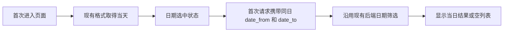

## Context

三个页面都复用 WeekBar 和 `/api/v1/source-items` 的 date_from/date_to。视频库当前 dayFilter 初始为 null，首次请求不带日期；观点和复核队列已初始为当天，已有请求逻辑正确携带日期。WeekBar 即使没有筛选也会标记今天的位置。已只读核对当前部署脚本指定运行主机的源码，初始化逻辑与本地一致；仍需浏览器核验实际请求及列表。

## Goals / Non-Goals

目标：默认进入页面就执行当前选中日期的筛选，效果等同已有单点筛选。

不涉及：重新定义数据日期、改时区、改后端筛选、增加日期组件、重写取数结构或改变手动选择交互。

## Decisions

- 直接在缺失默认日期的既有 state 初始化中使用现有 `weekbarFmt(new Date())`，使 WeekBar 的 value 和 reload 的参数取自同一个值。首个请求须带相同 date_from/date_to。
- 观点/复核队列若已正确初始化并发送日期，则保留代码，重点验收；不为了三个页面形式一致而增加无用改动。
- 保留“全部”和再次点击已选日期取消筛选的既有交互；不改时间线等其他页面的 WeekBar。
- 不用页面加载后的 effect 先显示全量再补筛选；这样避免默认状态与第一条请求再次不一致。

## Risks / Trade-offs

- [实际运行的静态构建与源码不同] → 验收分别记录本地构建与运行网页请求，不能用源码推断部署完成。
- [当天没有结果] → 显示空列表，不能回退全量；保持后端返回语义。

## Verification

用户要求不新增测试代码。用浏览器检查三个页面首次请求、已有单点选择、“全部”和空结果；运行现有 build/lint/test。只接受与显示日期一致的请求及响应结果。

## Flow

