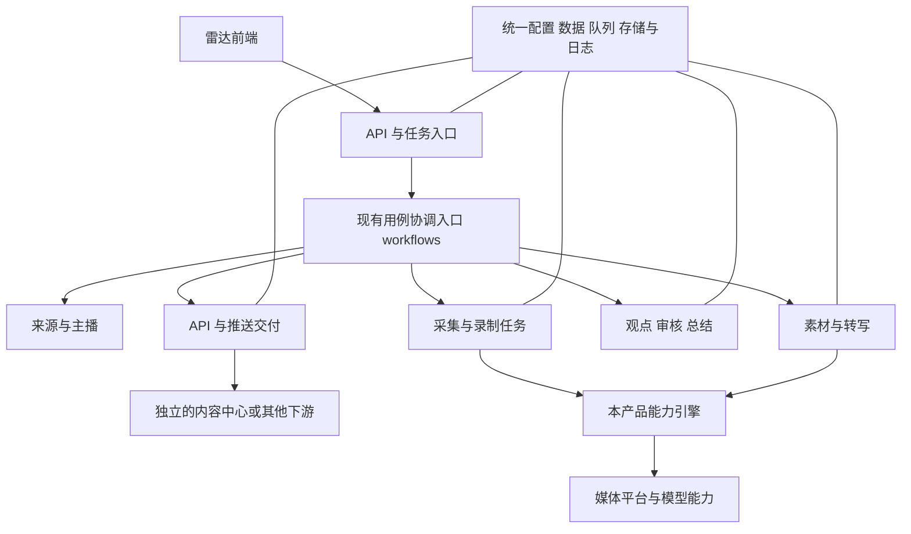

## Context

雷达已拥有自己的主播、素材、观点、审核、总结和交付业务。当前不完整的产品归属主要体现在外部 dtk API/任务栈、StreamCap 的配置文件与页面会话、douyinLive 服务，以及可选 MLX 转写对 voice-pro 环境的引用。证据及当前代码位置沿用根 [findings.md](../../../findings.md)。

用户的目标是全工程采用一套统一架构，成熟实现可以直接迁入再适配。“保留”只指有价值的功能、行为和代码，不要求保留原工程目录。架构提案以本地 main `b013bfe` 为基线，生产运行配置未在本轮核验。

## Goals / Non-Goals

**Goals:**

- 统一前后端、后台任务、能力引擎、配置和交付的工程组织与职责。
- 将必要实现变为本产品控制版本和维护的模块，解除旧产品目录、管理页面及整套旧应用的运行依赖。
- 当前业务功能、数据、证据、页面行为、日期及审核语义、已实现对外接口保持兼容。
- 在新环境仅安装本产品及其明确声明的正常依赖，即可运行现有完整业务链。

**Non-Goals:**

- 不合并 AI 内容中心或量化平台，不增加财经雷达之外的产品能力。
- 不附带框架版本升级、基础媒体/语音算法重写、全新页面视觉设计或新的微服务平台。
- 不实施其他尚待确认提案中的新增业务功能。
- 本次仅规范编制，不执行代码迁移、Git 合并推送、生产切换或旧生产环境下线。

## Decisions

### 1. 一个产品代码库，按职责组织为模块化架构

沿用现有 Python/FastAPI、React/TypeScript、Celery 及已使用的基础设施。目标是同一套架构与版本，而不是强制所有工作塞进一个进程。API、采集/转写 worker 和必要硬件引擎可分进程，均由雷达配置、启动和发布。

目标工程布局如下；这是迁移后的目录责任划分，不是本轮生成的代码脚手架。现有顶层名称继续使用，内部全部按本设计归位，避免无意义改名：

```text
apps/
  api/
    app/
      bootstrap/          应用、worker、调度器的组装与启动
      modules/
        workflows.py      现有跨模块用例的协调入口，不新增业务域
        sources/          主播、来源账号与监控意图
        collection/       发现、采集、录制与弹幕的业务任务
        content/          素材、媒体、转写、资产及保留期
        insights/         抽取、标签、证据、审核与总结
        delivery/         开放接口、Key、事件、订阅与投递
      runtime/            配置、数据库连接、队列、存储与既有日志支撑
    migrations/           原有业务库迁移与统一模型加载
  web/
    src/
      app/                应用入口、导航及页面装配
      features/           按上述业务职责归属页面、状态与调用
      shared/             已有公共组件、样式与请求基础设施
engines/
  media/                  所需平台解析、发现与下载实现
  recording/              所需直播检测、录制与切片实现
  danmaku/                所需直播消息协议实现
  transcription/          自包含的转写实现及可选硬件运行环境
infra/                    本产品的进程、容器和依赖配置
scripts/                  本产品安装、启动、构建、发布与维护入口
docs/                     设计及迁入代码的来源说明
tests/                    复用既有验证材料与检查
openspec/                 需求规范与本次成果
```

业务模块内部只按实际需要拆文件，复用现有实现，不要求每个模块额外制造相同的多层空目录。前端沿用当前可见功能与交互，把 App.tsx 中相应职责迁到 features；不以换皮代替工程整合。

### 2. 雷达业务模块拥有主流程，引擎只提供能力

模块负责业务数据、任务状态、审核判断和交付。能力引擎接受明确输入，返回结果或明确错误；它们不另行维护一套主播、视频、观点或推送业务真相。

API、调度器和 worker 调用同一业务处理实现，跨模块用例集中在 modules/workflows.py，bootstrap 只负责装配，不承载业务。配置由 runtime 统一加载。优先复用现有媒体与转写 contracts、队列、JobRun 及日志机制；不为整合再引入一套调度/工作流框架。

媒体文件与转录结果仍需要实际存储；目录和结果契约由雷达定义，引擎内部约定经适配后交付给业务层，主流程不再直接依靠另一完整产品的私有页面或目录结构工作。



图中箭头表示调用依赖，不代表各模块分别提交事务。业务先后顺序仍是采集、转写、审核总结和交付。

#### 2.1 数据拥有者与调用方向

| 数据或职责 | 拥有者与写入口 | 跨模块协作 |
|---|---|---|
| 主播、来源账号、监控意图 | sources | collection 通过 sources 的查询入口取得稳定账号标识和配置，不直接修改账号表 |
| 采集任务、录制及弹幕生命周期 | collection | 引擎报告结果；workflows 调用 content 摄入，collection 不直接修改转录和总结 |
| SourceItem、媒体资产、转录及直播分片进度 | content | 提供素材读取、更新和总结字段保存入口；保留原表结构和标识 |
| 观点、证据、审核规则与总结生成 | insights | 读取 content 提供的素材；总结文本和资格由 insights 计算，经 workflows 调用 content 保存现有 SourceItem 总结字段，不新建第二份总结真源 |
| VideoSummaryEvent、Key、订阅和投递记录 | delivery | workflows 提供审核资格、来源指纹和总结快照，delivery 生成事件；推拉读取同一事件记录 |

依赖规则：入口调用 workflows 或本域处理；workflows 调用各域的明确入口，各域不反向调用 workflows。insights、collection 可使用 content/sources 的查询或写入契约，但不能越过它们操作私有仓储；content/sources 不反向导入 insights/delivery。delivery 不反向导入 insights 做审核判断；需要实时资格检查的开放接口也走 workflows 组合查询。runtime 不依赖业务域，引擎不直接写雷达业务表。既有跨域调用按该方向迁移，不以新增事件总线解除循环。

#### 2.2 来源、审核、总结和交付事件的事务

- 跨域写用例由 workflows 持有同一数据库 session 和提交/回滚责任；参与此用例的域操作只修改或 flush，不自行 commit。单域用例仍可拥有自己的事务。
- 来源信息或审核资格变化时，在该次变更事务内读取变更后的资格/指纹，必要时通过 delivery 撤回旧 ready 版本；来源变更和 withdrawn 事件一起提交或一起回滚。
- 总结生成保留现有“生成前指纹—生成后复核”语义。耗时模型调用在写事务之外；写入时重新锁定并核对资格和指纹，保存总结与 ready 事件同事务提交。资格改变则不能发布该候选总结。
- 沿用现有锁顺序：先锁对应 SourceItem，再取得既有事件顺序锁；迁移时核对所有生成、撤回及删除用例，保留原事件排序/游标规则，不增加另一套锁或事件编号器。
- 推送网络调用不纳入上述数据库写事务；继续由现有投递任务消费已提交的事件。事务失败不得留下只更新总结或只产生事件的半成品。

### 2.3 持续运行引擎的交付契约

录制、弹幕是持续任务，不能只按一次输入/输出迁移。collection 管理业务会话、唯一执行者及启动/停止/恢复；引擎负责平台协议、媒体写入和退出反馈，content 管理摄入与处理进度。

| 环节 | 迁移后必须明确的约定 |
|---|---|
| 启动与身份 | 传入稳定账号/会话标识及所需配置；沿用现有会话和分片身份映射，不按新目录重新生成视频身份。弹幕继续使用既有按视频的会话锁和独立队列 |
| 录制交付 | 交付会话标识、分片标识、位置及完成状态；只有确认关闭且可读的完整分片才交给 content。迁移期间保留现有文件稳定等待逻辑，不能把正在写入的文件当作已处理 |
| 摄入与证据 | content 以既有会话/分片标识核对 processed、deferred、errors 和恢复路径；保留转录累计偏移及短残片处理语义。提交处理结果后才记录完成，同一分片重交不得重复追加转录 |
| 弹幕交付 | 保留独立 JSONL/消息摄入、既有去重和心跳语义；观众消息不并入主播转录。协议重连继续由采集循环负责，不另加一层无限重试 |
| 停止与异常 | collection 接收停用、正常结束或进程退出结果；引擎收尾已完成分片并报告未完成部分，释放原会话资源。异常退出不能当作正常完成；未完成文件留在待核对状态 |
| 恢复与重试 | 进程恢复前确认旧执行者已退出并取得原单飞控制，读取既有进度，从未完成部分接续。分片处理沿用业务层现有重试次数/退避，协议连接沿用引擎重连；同一失败不由两层重复派发业务任务 |

实际来源代码核实后，固定每个引擎的函数或进程入口与字段映射；无需为这些约定再建设通用任务平台。迁移验收必须包含未完成分片和异常退出后的接续，不只证明正常结束一次成功。

### 3. 成熟代码按调用链迁入，运行环境同时接管

| 现有部分 | 目标责任 | 必须处理的实际耦合 |
|---|---|---|
| dtk 客户端与外部服务栈 | collection 使用 engines/media | 定位实际解析/发现调用所需源码、鉴权签名及依赖；业务任务进入雷达已有任务系统，不能仅把原完整服务换个名称保留 |
| StreamCap + recorder_bridge + live_ingest | collection/content 配合 engines/recording | 录制生命周期由本产品进程启动；分片交付与账号映射归雷达管理，替换对原管理页面会话和 recordings.json 的直接业务依赖 |
| douyinLive + collector | collection 使用 engines/danmaku | 迁入协议能力或本产品维护的引擎进程；连接和消息交付由雷达管理，复用现有观众消息与主播转录分离语义 |
| faster-whisper / 可选 MLX 桥接 | content 使用 engines/transcription | 复用已有 provider 契约；迁入必要 worker 和依赖安装，移除 voice-pro Python/worker 路径前提 |
| 原 API/services/repositories/db/worker | 五个业务模块、runtime、bootstrap | 按职责移动实现并同步调用、模型加载和任务注册；临时兼容转发不承载业务，迁移后无引用即移除 |
| App.tsx 中的页面和状态 | web app/features/shared | 按职责迁移，保留当前导航、筛选、审核和服务目录交互 |

能直接作为库安装的实现直接打包使用；确需不同语言或硬件环境的实现作为本仓库可构建的引擎进程交付，不强制改写成 Python，也不继续借用旧产品工作区。安装清单需包含 engines 的实际构建/安装步骤，不能只移动源码后依赖手工 sys.path 或外部虚拟环境。

当前尚未完整读取来源工程，不能事先断言 dtk 哪些内部数据库或运行依赖可以直接删除。实施第一步须冻结来源版本和必要调用链，把确需保留的身份、配置或缓存职责接入本产品；无用的原产品页面、业务调度和完整部署栈不纳入最终运行前提。迁入时保留实际来源、版本及必要许可说明，自主产品架构不等于把复用代码宣称为原创。

### 4. 兼容业务行为和存量数据，统一内部组织

优先复用现有雷达业务库及表结构。目录调整同步 ORM 模型发现、Alembic 配置、打包、导入和任务路由，不因重排代码重建业务库或重新编号。

主播与视频标识、原始转录和证据、审核状态、总结及版本、事件顺序和游标、订阅与投递记录继续有效。视频时间与数据日期的现有口径保持。接口路径、鉴权、字段、服务目录和已支持的推拉行为以当前已实现代码冻结清单为准；其他未完成提案不自动算作本次功能。

新代码使用迁移后的模块。兼容旧内部入口只用于迁移过渡，清理完成后业务不能仍依赖另一套旧目录。保留现有 HTTP 地址或必要运维入口时，应委托统一实现，不形成双份业务流程。

### 5. 一个安装配置和发布责任入口

各入口从同一产品配置装配，运行参数不再需要用户进入旧产品管理页面重复维护；必要 Cookie、代理、凭据和模型配置仍由本产品支持和管理。

安装和依赖清单明确数据库、Redis、对象存储、FFmpeg、模型/API 及不同硬件的已支持转写路径。普通基础设施和模型依赖可保留；整合不要求物理删除必要进程或把所有能力塞进一个容器。现有 Makefile 与脚本按统一入口整理，避免再保留互相矛盾的旧产品启停流程。

## Risks / Trade-offs

- [迁入片段还依赖原工程内部状态或组件] → 先冻结实际调用链、来源版本和必要运行依赖，迁入后在没有旧工程目录的环境验收。
- [移动目录遗漏模型、任务或打包入口] → 逐模块同步导入、ORM 加载、Celery 注册和构建入口，复用现有检查；只改目录不算验收通过。
- [接口或数据在迁移中被改变] → 冻结当前接口与数据标识，核对审核、证据、版本、游标与投递行为，不进行无关业务改造。
- [全工程调整影响正在使用的系统] → 在隔离工作区完成并验证后再申请生产切换；实施期间不让新旧调度同时处理同一批业务任务。

## Migration Plan

1. 用户确认本提案后，冻结现有能力与依赖清单、来源版本、对外契约和已有检查基线，写入同一成果目录。
2. 建立目标模块与统一装配入口，按一条“采集 → 转写 → 审核总结 → 交付”链路迁移既有实现；实际文件按职责移动，不只建空壳。
3. 迁入各能力引擎并接管安装配置和生命周期，补齐直播录制、弹幕及当前支持的转写路径，逐项解除旧产品运行前提。
4. 按同一架构整理前端页面与调用、模型加载、任务入口、启动和部署配置；清理无引用的旧内部目录、桥接和旧产品安装入口。
5. 运行既有相关检查及前端构建，在不提供旧项目目录、虚拟环境或页面会话的独立环境验证完整现有流程和推拉兼容；不新增测试代码，不把未完成人工基准当作架构验收结果。
6. 完成下面的存量接续及回退演练，更新成果与 README 并归档。Git 合并推送、生产发布和旧环境下线按后续明确授权执行；生产切换前保留旧产物和配置回滚材料，避免不可逆数据变更。

### 存量接续与回退演练

演练使用隔离数据库、队列和媒体副本以及隔离接收端，禁止让验收任务访问生产队列或向真实订阅方重复推送。使用获准的存量副本或本地已有人为构造的数据，记录其来源和限制；不能以空库启动证明历史兼容。

1. **固定切换清单**：记录源码/构建版本、任务名及参数/队列、排队和执行中的任务、活跃直播会话、分片进度及路径、事件游标、订阅和投递状态。保留旧产物、配置和必要数据备份；不得仅备份数据库而遗漏媒体文件。
2. **停止新派发并交接在途工作**：暂停旧 beat 和其他任务入口。可排空的任务先排空；长录制/弹幕在可确认的分片边界收尾，无法完成的部分记录待恢复状态。确认旧执行者退出后才让新执行者接管；不清空队列或将未完成任务统一重置成新任务。
3. **接通旧消息与文件**：内部模块可改名，已有 Celery 任务名、队列和参数仍可被新版本消费；必要兼容入口仅转发新实现，排空旧消息后才移除。核对数据库中的 storage URI、segment_paths、弹幕文件及挂载路径，优先保持数据位置，确需映射时保留可逆映射和原文件，逐项读回待处理对象。
4. **启用唯一执行者并核对接续**：启用新 worker/引擎和单套调度，读回分片不重复、偏移不变、审核及事件一致、游标连续、投递状态延续。sent/dead/unknown 保持现有处理语义，unknown 不因迁移重新发送；失败项继续原重试状态。
5. **演练回退**：出现旧任务无法消费、媒体无法读取、重复摄入或事件不一致时，先暂停新派发及执行者并记录新增状态。只有已验证旧代码能读取新写入的数据/队列/文件时，才用旧产物与配置接续；否则停止在隔离演练阶段，补齐可逆迁移后重演。不能以恢复旧代码宣称回退成功，也不能直接回滚数据库快照抹去已交付事件。

证据写入同一成果目录：切换前后版本、任务/媒体标识及处理结果、事务失败与资格变化的检查结果、接收端读回和一次回退接续结果。现有检查没有覆盖的情况可通过人工操作和现有工具验证，不新增测试代码。清理旧入口前须确认相关旧任务与文件引用已消化或兼容；生产删除、停机和发布仍需对应授权。

## Open Questions

产品边界与整合方向已明确，不再重复询问。具体来源仓库、版本、必要依赖与可迁入范围尚待实施首步核实；当前目标布局是本提案的待确认技术设计，不是已经完成的改造。
